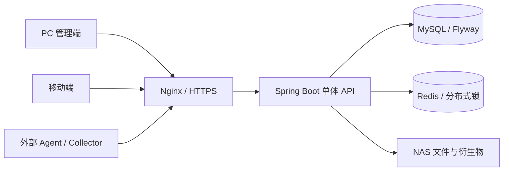

# 当前系统架构

> 现行实现摘要，2026-11-02，基线 `132c9e6`。依赖精确版本以 pom、package-lock 和部署清单为准。

BladeProject 是服装批发业务单体应用：PC 管理端为主，移动端已有部分页面；后端集中处理业务动作，MySQL 存业务数据，Redis 支持锁与缓存，NAS 本地存文件及衍生物。微信和完整财务不是已交付主系统。

## 技术与目录

| 部分 | 当前声明 | 目录 |
|---|---|---|
| PC | Vue 3、TypeScript、Vite 8、Element Plus 2、Pinia 3、Router 5 | `blade-admin/` |
| 移动 | Vue 3、Vite 8、Vuetify 4、Router 4、PWA 插件 | `blade-mobile/` |
| 共享 | TypeScript 业务类型 | `packages/types/` |
| 后端 | Java 17、Spring Boot 3.2.4、Security、MyBatis-Plus | `blade-backend/` |
| 数据 | MySQL 8、Redis 7、Flyway V1–V69 累计迁移 | `blade-backend/src/main/resources/db/migration/` |
| 运维 | NAS 容器、Nginx、发布清单与备份 | `deploy/nas/` |

Node 环境按仓库配置使用 22。源码依赖状态与 NAS 实际镜像版本分别维护，不应把当前 package 版本直接当成已发布 Web 的构建清单。

## 业务边界

- 订单：OrderActionService 统一动作；OrderAccessPolicy 限制档口×人员范围；旧 status 通过兼容适配器投影。
- 财务：逐笔收款、退款、核销和金额快照，限定订单场景；通用 AR/AP、账户总账未实现。
- 履约：正式单结清后选择 STOCK_LINKED 或 RECORD_ONLY；只有前者进入真实 SKU、配货和库存出库。
- 库存：事务、Redis 分布式锁、版本控制；写动作授权仍有缺口，见代码评估。
- 文件：NAS 本地文件、业务关联、访问策略、异步衍生物和预览；OSS 是扩展方向，不能描述为生产现状。
- Agent：独立 Key 与 scope，叠加租户和档口范围；纸单只进入草稿，必须人工确认正式单。

## 身份和数据范围

普通用户使用 JWT，UserDetailsServiceImpl 返回 AuthenticatedUserDetails。业务实体 User 不是实际 principal；仍只判断业务 User 的消费者需要修复，不能默认回退管理员。

租户来自可信请求上下文，TenantLineHandler 对受管业务表加过滤；缺失租户 fail closed。全局权限定义和少数不含 tenant_id 的关系表有明确例外，不代表超级管理员可以任意绕过租户。按钮权限与数据范围是两道独立控制。

普通 API 全局要求登录；敏感动作需要方法授权和业务策略；订单/草稿/统计/导出/文件出口必须一致。当前库存写接口缺少动作级闸门，已列为 P1 修复。

## 关键持久化与变更

精确结构来自累计 Flyway，而非手工复制一份 CREATE TABLE。财务快照和日志需随动作事务更新；订单兼容字段不能被新逻辑直接驱动。表关系摘要见 [数据库参考](./DATABASE.md)。

[现行范围](../PROJECT_SCOPE.md)、[生命周期](../14-ORDER_LIFECYCLE_REFACTOR_DESIGN.md)、[档口权限](../20-OUTLET_ACCESS_CONTROL_DESIGN.md) 定义契约；[代码评估](../CODE_REVIEW_2026-11-02.md) 记录尚未完成的改进；[NAS 手册](../13-NAS_PRODUCTION_OPS.md) 区分应用发布、schema 迁移与业务数据迁移。
